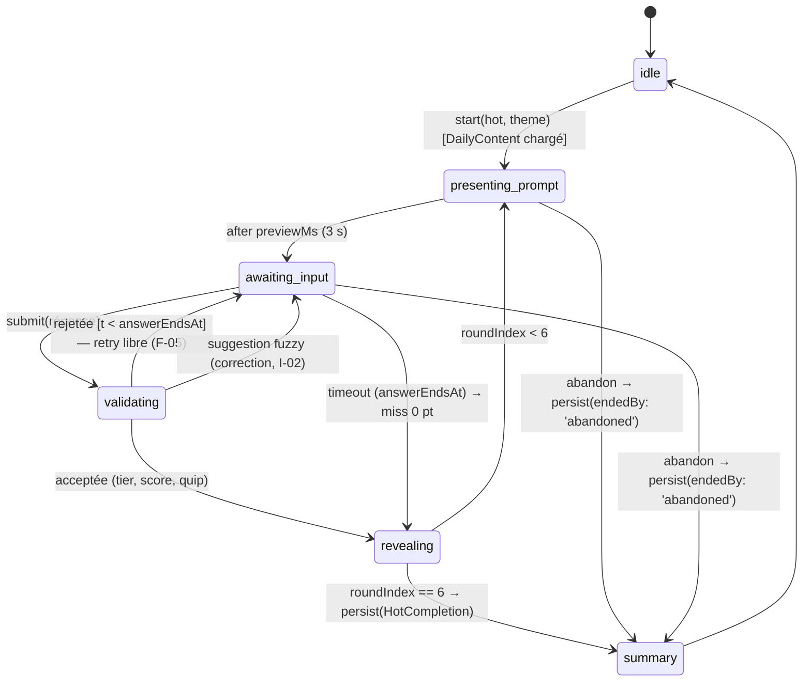
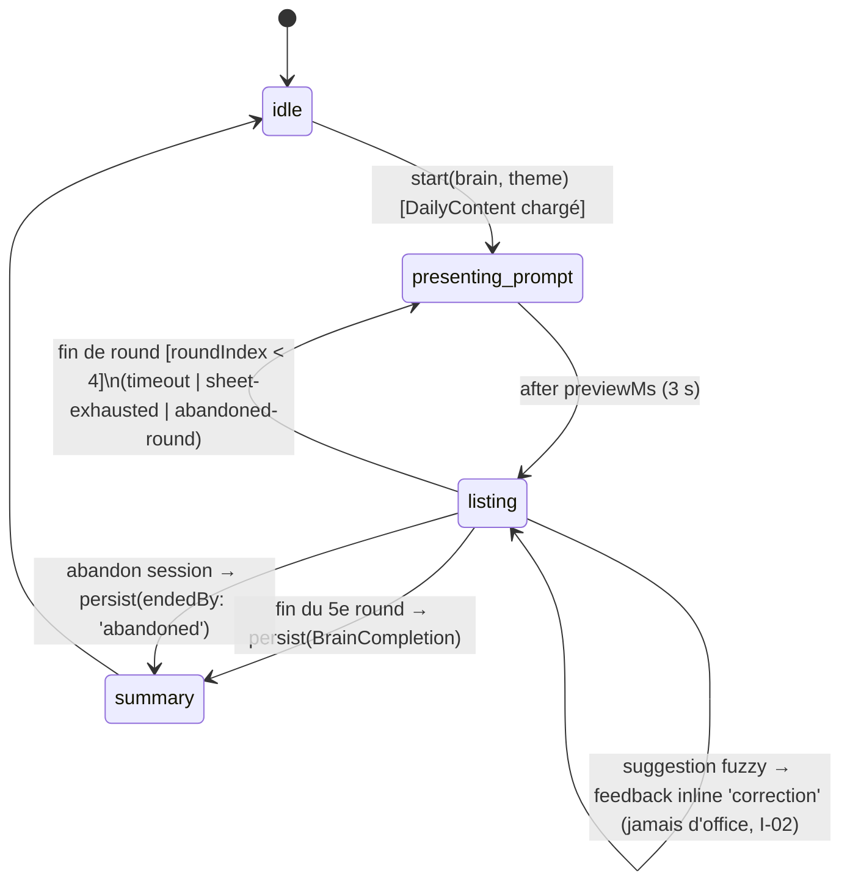

# Ontologie & Modèle de Données — livrable de l'agent Ontologie
**Version :** 3.1 · **Date :** 2026-11-09 · **Base :** WSD v0.8, DECISIONS.md (D-01→D-20, F-1→F-22), mécaniques.md v1+v2
**Sources primaires (recon de l'original, 2026-11-08) :** chunks JS `/_next/static/chunks/*` de krillion.io (`recon/chunks/`), pages `/faq` et `/privacy` (`recon/pages/`), site fan krilliondaily.com.

**Changelog v3 (propagation produit du 2026-11-09) :** rebranding HotBrain (namespace `abysse:*` → `hotbrain:*`, terrain vierge = aucune migration de clés) · multi-thèmes D-07/D-10 (`ThemeId` extensible, invariant Général ∩ thèmes = ∅) · remplacement Daily/Unlimited par les modes **Hot** (7 × 25 s) et **Brain** (5 × 60 s, liste) — `DiveState` devient une union discriminée par mode · paliers = IDs stables `t1..t6` + labels séparés · epoch = paramètre de config (D-13) · F-9 tranché : feuilles lisibles, hashage supprimé.

**Changelog v3.1 (patch du 2026-11-09, WSD v0.8) :** F-14 → `BrainDiveState.duplicatesIgnored` (compteur persisté) · F-15 → `BrainCompletion.ceiling` (plafond des 5 feuilles, survit à la purge du cache — ratio de partage D-19) · alignement décisions : D-16 (streak = toute complétion daily) · D-17 (**`playKind: 'daily' | 'unlimited'`** sur `DiveState`/`Completion` — Hot ET Brain ont chacun Daily + Illimité) · D-18 (daily Général seul, type extensible) · D-20 (séries Hot/Brain indépendantes — question §1.8 close) · D-14 (label t2 = « Réchauffé » acté).

> Rappel D-01 : la section A documente la **structure** de l'original (recon légale) ; tout le contenu HotBrain (prompts, réponses, labels, visuels) est original.

---

## A. FAITS OBSERVÉS vs INFÉRENCES (recon de l'original — référence structurelle)

### A.1 Faits observés (inchangés depuis v2, origine entre parenthèses)

- **F-01** : 6 paliers, scores 10 / 15 (palier-piège « Too Clever ») / 30 / 60 / 85 / 100, chacun avec fraction de placement sur la jauge (chunk `1klevf566y93_.js`, module `86062`).
- **F-02** : `MAX_DAY_SCORE = 700`, `ROUNDS_PER_DAY = 7`, bandes de verdict 0–150 / 151–250 / 251–350 / 351–449 / 450+ (même module).
- **F-03** : `ANSWER_MS = 25000`, `PREVIEW_MS = 3000` (chunk `0mbol4x_20ygq.js`, module `98890`).
- **F-04** : `MAX_ANSWER_LENGTH = 256`.
- **F-05** : réponse refusée ≠ manche perdue : retry libre dans la fenêtre ; 0 pt seulement au timeout (chunk `0a2u9ia29qr0q.js`).
- **F-06** : fuseau `America/New_York`, calendrier ancré sur une date d'époque, reset minuit local (module `98284`) — confirmé pour HotBrain par D-13, **avec notre propre epoch** (date de lancement, paramètre de config).
- **F-07** : phases `intro → preview → answering → feedback → done`, pause/reprise par décalage des deadlines.
- **F-08** : résultat de manche `{promptId, promptText, rawAnswer, answer, tier, score, quip?}` ; validateur strict à la lecture.
- **F-09/F-10/F-11/F-12** : clés localStorage namespacées et versionnées (`:v1`), complétion `{kind, scope, game, score, tiers[7], results[7], version}`, stats dérivées (streak sur dates civiles consécutives), `playerId` = UUID local.
- **F-13→F-16** : API de l'original (today/submit/reveal/complete) — référence pour le futur serveur (§D.3).
- **F-17/F-18** : pratique de recalibrage de la rareté sur réponses réelles ; feuilles « thousands of accepted answers » possibles, alias, autocorrect ±1–2 lettres.
- **F-19** : jalons de jauge thématiques de l'original (océan). **Caduc pour HotBrain** (D-06/D-09 : thermomètre 0→700 °C, jalons 37/100/233/700 °C provisoires) — conservé ici comme preuve que la jauge est une liste de jalons `[position, label]`, structure réutilisable.

### A.2 Inférences (étiquetées)

- **I-01** *(révisée par F-9 tranché)* : l'original ne distribue les feuilles qu'après la partie (`/api/reveal`). **HotBrain, offline-first + F-9 « lisible » : les feuilles sont embarquées en clair** — toute option de hashage/obfuscation est **supprimée du schéma** (le `sheetsHash` de v2 disparaît).
- **I-02** : la suggestion fuzzy est présentée au joueur, jamais appliquée d'office (confirmé par F-9 « fuzzy complet »).
- **I-03** : le champ `version` des complétions + re-note post-partie = forme primitive de notre recalcul D-03.
- **I-04** : les fractions de palier servent au placement visuel sur la jauge (chez nous : thermomètre, `gaugeFraction`).
- **I-05** : la donnée de rareté dynamique vient du volume de réponses réelles, pas de votes directs.

---

## B. SCHÉMA D'ENTITÉS CIBLE — HotBrain (TypeScript strict)

```ts
// ─────────────────────────────────────────────────────────────
// 0. Configuration produit (paramètres, PAS des constantes en dur)
// ─────────────────────────────────────────────────────────────

/** Epoch et fuseau sont de la CONFIG (D-13 : minuit NY confirmé ;
 *  epoch = date de lancement HotBrain, à fixer au déploiement). */
export interface GameConfig {
  timezone: string;                 // "America/New_York" (D-13)
  epochDate: string;                // "YYYY-MM-DD" — jour n° 1, À FIXER au lancement
  modes: {
    hot:   { rounds: 7; previewMs: 3_000; roundMs: 25_000 };   // F-02/F-03
    brain: { rounds: 5; previewMs: 3_000; roundMs: 60_000 };   // D-11
  };
  maxAnswerLength: 256;             // F-04
}

// ─────────────────────────────────────────────────────────────
// 1. Thèmes (D-07, D-10, extensible pour D-08)
// ─────────────────────────────────────────────────────────────

/** Thèmes connus de HotBrain. */
export type KnownThemeId =
  | 'general'           // culture générale TOUS domaines — PAS un agrégat des 6 autres
  | 'geography'
  | 'entertainment'
  | 'history'
  | 'arts-literature'
  | 'science-nature'
  | 'sports-leisure';

/** Extensible par construction (D-08 : le jeu Football réutilise ce moteur
 *  avec son propre thème ; le moteur traite ThemeId comme opaque). */
export type ThemeId = KnownThemeId | (string & {});

// ─────────────────────────────────────────────────────────────
// 2. Modes de jeu (D-04 remplacé, D-11, D-12)
// ─────────────────────────────────────────────────────────────

export type GameMode = 'hot' | 'brain';

// ─────────────────────────────────────────────────────────────
// 3. Paliers — IDs STABLES, labels JAMAIS structurels (D-05, D-06)
// ─────────────────────────────────────────────────────────────

/** Identifiants stables : toute donnée persistée référence l'ID, jamais le label. */
export type TierId = 't1' | 't2' | 't3' | 't4' | 't5' | 't6';

export interface Tier {
  id: TierId;
  points: number;          // t1:10 · t2:15 (palier-piège, D-05) · t3:30 · t4:60 · t5:85 · t6:100
  gaugeFraction: number;   // 0..1 — placement sur le thermomètre (I-04)
  emoji: string;           // ligne de partage anti-spoiler
  colorToken: string;      // variable CSS
}

/** Labels ACTÉS (D-14, orchestrateur 2026-11-09) — table séparée,
 *  renommable sans toucher aucune donnée persistée :
 *  t1 Tiède · t2 Réchauffé (piège) · t3 Chaud · t4 Brûlant · t5 Incandescent · t6 Fusion. */
export type TierLabelTable = Record<TierId, string>;

/** Bandes de verdict sur le score TOTAL d'une session (F-02 ; échelle °C, D-09). */
export interface ScoreBand {
  min: number;
  tier: TierId;
  verdict: string;         // phrase de fin — contenu original
}

// ─────────────────────────────────────────────────────────────
// 4. Contenu : prompts, feuilles, banques
// ─────────────────────────────────────────────────────────────

export interface Prompt {
  id: string;                 // slug stable, unique TOUTES banques confondues
  theme: ThemeId;             // exactement un thème — voir invariant banque ci-dessous
  text: string;               // contenu 100 % original (D-01)
}

export interface AnswerSheetEntry {
  answer: string;             // forme canonique affichée
  tier: TierId;
  aliases: string[];
  quip?: string;
}

export interface AnswerSheet {
  promptId: string;
  entries: AnswerSheetEntry[];      // taille libre (F-18) — CONTRAT : ≤ 2 000 clés
                                    // normalisées (answer + aliases) par prompt (F-8)
  contentVersion: number;           // pilote le recalcul progressif (D-03, I-03)
  stats?: {                         // télémétrie de rareté (D-03)
    [normalizedAnswer: string]: { submissions: number; lastSeenAt: string };
  };
}

/** Banque d'un thème. INVARIANT DU VALIDATEUR DE BANQUE (D-10) :
 *  banque('general') ∩ banque(t) = ∅ pour tout t ≠ 'general'
 *  (un prompt thématique n'apparaît JAMAIS en Général ; Général = culture générale
 *  tous domaines, pas un fourre-tout). Le validateur vérifie aussi :
 *  unicité globale des promptId, présence d'exactement un theme par prompt,
 *  ≥ 1 entrée par feuille, cohérence tier ∈ TierId. */
export interface PromptBank {
  theme: ThemeId;
  prompts: Prompt[];
  sheets: Map<string, AnswerSheet>;   // promptId → feuille (lisible, F-9 tranché)
  contentVersion: number;
}

/** Série quotidienne d'UN mode pour UN thème (reset minuit NY, D-13).
 *  Hot et Brain ont chacun leur série (D-11 : 7 prompts vs 5 prompts).
 *  D-20 TRANCHÉ : séries Hot/Brain INDÉPENDANTES (pas de spoil croisé) —
 *  hot.promptIds ∩ brain.promptIds = ∅ à (theme, date) donné. Le schéma reste
 *  capable de supporter des séries partagées si la décision était révisée.
 *  D-18 TRANCHÉ : seul le thème 'general' a une série quotidienne fraîche ;
 *  les 6 thèmes sont servis en illimité depuis leur banque statique (D-17).
 *  Le champ `theme` reste typé ThemeId (pas 'general') → extensibilité préservée
 *  (daily thématique futur, ou jeu Football D-08) sans migration.
 *  La sélection effective est du ressort du Mécaniques (seed FNV-1a(theme:mode:dayNumber)). */
export interface DailyContent {
  theme: ThemeId;                   // aujourd'hui : toujours 'general' (D-18)
  date: string;                     // "YYYY-MM-DD" dans config.timezone
  dayNumber: number;                // jours civils depuis config.epochDate + 1
  mode: GameMode;
  promptIds: string[];              // 7 (hot) ou 5 (brain) — référence la PromptBank du thème
  contentVersion: number;           // version des feuilles au moment de la génération
}

// ─────────────────────────────────────────────────────────────
// 5. Normalisation de saisie (inchangé — 6 étapes, ordre exact)
// ─────────────────────────────────────────────────────────────
//  1. trim + lowercase + NFC · 2. pliage diacritiques (NFD → strip marques)
//  3. tirets/apostrophes → espaces · 4. suppression ponctuation résiduelle
//  5. compaction des espaces · 6. suppression articles initiaux
//  Match : exact sur answer+aliases, sinon suggestion fuzzy Damerau ≤ 1–2
//  (seuil par longueur — règle fine : Mécaniques), jamais appliquée d'office (I-02).

export interface CorrectionSuggestion {
  from: string;
  to: string;
}

// ─────────────────────────────────────────────────────────────
// 6. Résultats de round — discriminés par mode
// ─────────────────────────────────────────────────────────────

/** HOT : une réponse par prompt (F-05 : retry libre, miss seulement au timeout). */
export interface HotRoundResult {
  promptId: string;
  promptText: string;             // copie figée au moment du jeu (F-08)
  rawAnswer: string | null;       // saisie brute ; null si timeout sans saisie
  answer: string | null;          // canonique acceptée ; null = miss
  tier: TierId | null;            // null = miss (0 pt)
  score: number;                  // 0..100
  quip?: string;
}

/** BRAIN : une réponse acceptée (D-11). Horodatage = horloge monotonique,
 *  ms écoulées depuis le début du round (rejeu/débogage ; pas une deadline). */
export interface AcceptedAnswer {
  rawAnswer: string;              // saisie brute du joueur
  answer: string;                 // forme canonique matchée (après correction éventuelle)
  tier: TierId;
  score: number;                  // Tier.points au moment du jeu
  at: number;                     // ms mono relatives au début du round
  viaCorrection: boolean;         // true si acceptée via CorrectionSuggestion confirmée
}

/** BRAIN : fin de round. 'timeout' = 60 s écoulées ; 'sheet-exhausted' = toutes
 *  les entrées trouvées ; 'abandoned' = geste d'abandon du joueur.
 *  NB : l'épuisement termine-t-il le round en avance ? → À TRANCHER par Mécaniques
 *  (le type supporte les deux politiques). */
export type RoundEndReason = 'timeout' | 'sheet-exhausted' | 'abandoned';

export interface BrainRoundResult {
  promptId: string;
  promptText: string;
  answersGiven: AcceptedAnswer[]; // ordre chronologique ; doublons ABSENTS (ignorés)
  score: number;                  // Σ answersGiven.score — plafond = Σ points de la feuille
  endReason: RoundEndReason;
}

export type RoundResult = HotRoundResult | BrainRoundResult;

// ─────────────────────────────────────────────────────────────
// 7. États de session — union discriminée par mode
// ─────────────────────────────────────────────────────────────

/** Phases. 'answering'/'feedback' = hot ; 'listing' = brain (feedback INLINE,
 *  pas de phase dédiée — voir ListingFeedback). */
export type GamePhase =
  | 'intro'
  | 'preview'        // prompt affiché, chrono pas lancé (previewMs)
  | 'answering'      // HOT : saisie d'UNE réponse, answerEndsAt = borne 25 s
  | 'listing'        // BRAIN : accumulation de réponses, answerEndsAt = borne 60 s
  | 'feedback'       // HOT : verdict du round
  | 'done';

/** Feedback transitoire du mode Brain (affiché inline pendant 'listing').
 *  'duplicate' = doublon ignoré (feedback d'état dédié — D-11) ;
 *  'rejected' = hors feuille ; 'correction' = suggestion fuzzy en attente ;
 *  'accepted' = dernière validation (flash de points). */
export interface ListingFeedback {
  kind: 'accepted' | 'duplicate' | 'rejected' | 'correction';
  input: string;                  // saisie concernée
  to?: string;                    // forme suggérée si kind === 'correction'
  score?: number;                 // points gagnés si kind === 'accepted'
  at: number;                     // ms mono — permet à l'UI d'expirer le feedback
}

/** D-17 TRANCHÉ : Hot ET Brain ont chacun un Daily ET un Illimité (4 combinaisons).
 *  `playKind` distingue les deux dans chaque mode — discriminant de cycle de vie
 *  (daily : soumis au reset NY, alimente le streak, série figée ; unlimited :
 *  libre, tirage sans remise persistant sur l'historique, remise totale à épuisement). */
export type PlayKind = 'daily' | 'unlimited';

interface DiveStateBase {
  mode: GameMode;
  playKind: PlayKind;               // D-17
  theme: ThemeId;
  date: string;                     // daily : date NY de la série ; unlimited : id de session
  dayNumber: number;                // daily : n° du jour ; unlimited : compteur local
                                    // (complétions unlimited persistées du couple mode×theme + 1)
  roundIndex: number;
  phase: GamePhase;
  previewEndsAt: number | null;   // horloge monotonique ms (persisté en couple mono/wall, §D.2)
  answerEndsAt: number | null;    // deadline du round courant (hot : 25 s ; brain : 60 s)
  draft?: string;                 // saisie en cours (survit au rechargement)
  pausedAt?: number;              // décale les deadlines à la reprise (F-07)
  /** Graine de tirage des sessions UNLIMITED — uint32.
   *  Générée une fois à la création (crypto.getRandomValues), persistée,
   *  jamais régénérée en cours de session. Absente en daily (tirage seedé
   *  par (theme, mode, dayNumber) — règle de sélection : Mécaniques). */
  sessionSeed?: number;
}

export interface HotDiveState extends DiveStateBase {
  mode: 'hot';
  phase: 'intro' | 'preview' | 'answering' | 'feedback' | 'done';
  results: HotRoundResult[];      // length === roundIndex hors 'feedback'
  correction?: CorrectionSuggestion | null;
  rejected?: string | null;       // dernière réponse refusée (retry libre, F-05)
}

export interface BrainDiveState extends DiveStateBase {
  mode: 'brain';
  phase: 'intro' | 'preview' | 'listing' | 'done';
  results: BrainRoundResult[];    // rounds terminés
  currentAnswers: AcceptedAnswer[]; // round EN COURS — persisté (reprise après
                                    // rechargement en pleine liste, §D.2)
  lastFeedback?: ListingFeedback | null;
  /** F-14 : doublons ignorés depuis le début de la session (tous rounds confondus).
   *  Incrémenté à chaque feedback 'duplicate' (y compris fuzzy vers une entrée
   *  déjà récoltée — Mécaniques v2). Persisté avec l'état ; recopié tel quel dans
   *  BrainCompletion.totals.duplicatesIgnored à la complétion. */
  duplicatesIgnored: number;
}

export type DiveState = HotDiveState | BrainDiveState;

// ─────────────────────────────────────────────────────────────
// 8. Complétions persistées — discriminées par mode
// ─────────────────────────────────────────────────────────────

/** 'completed' = 7/5 rounds joués ; 'abandoned' = geste d'abandon.
 *  F-11 ACTÉ : une daily abandonnée est CONSOMMÉE (non rejouable comme daily)
 *  et n'alimente PAS le streak ; la complétion partielle est persistée pour
 *  des stats honnêtes. */
export type CompletionEnd = 'completed' | 'abandoned';

interface CompletionBase {
  mode: GameMode;
  playKind: PlayKind;             // D-17 — daily vs unlimited, dans chaque mode
  theme: ThemeId;
  scope: string;                  // daily : date ISO ; unlimited : n° de session
  game: number;                   // dayNumber
  score: number;                  // revérifié à la lecture contre les paliers
  contentVersion: number;         // dernière version de feuille appliquée (F-6)
  endedBy: CompletionEnd;
  imported?: boolean;             // futur sync serveur
}

export interface HotCompletion extends CompletionBase {
  mode: 'hot';
  tiers: (TierId | 'miss')[];     // exactement 7 si endedBy === 'completed'
  results: HotRoundResult[];
}

export interface BrainCompletion extends CompletionBase {
  mode: 'brain';
  results: BrainRoundResult[];    // exactement 5 si endedBy === 'completed'
  /** F-15 : plafond = Σ points des 5 feuilles AU MOMENT DU JEU.
   *  Figé à la complétion pour que le ratio de partage D-19 (score/ceiling)
   *  survive à la purge du cache contenu (14 j, §D.2) et au recalcul D-03. */
  ceiling: number;
  totals: {
    answersAccepted: number;
    duplicatesIgnored: number;    // recopié depuis BrainDiveState.duplicatesIgnored (F-14)
  };
}

export type Completion = HotCompletion | BrainCompletion;

// ─────────────────────────────────────────────────────────────
// 9. Joueur & stats (dérivées — jamais source primaire)
// ─────────────────────────────────────────────────────────────

export interface PlayerStats {
  gamesPlayed: number;
  totalScore: number;
  bestScore: number;
  currentStreak: number;          // dates NY consécutives avec ≥ 1 complétion DAILY
  maxStreak: number;              // — D-16 ACTÉ : tout mode, tout thème.
  lastPlayedDate: string | null;  //   F-11 ACTÉ : endedBy='abandoned' n'alimente
                                  //   PAS le streak (daily consommée quand même)
}

/** Chaque Completion porte mode + theme → toutes les découpes sont dérivables. */
export interface PlayerStatsBreakdown {
  overall: PlayerStats;
  byMode: Record<GameMode, PlayerStats>;
  byTheme: Partial<Record<ThemeId, PlayerStats>>;
}

export interface PlayerProfile {
  playerId: string;               // UUID local anonyme (F-12)
  createdAt: string;
  preferences: {
    muted: boolean;
    colorblind: boolean;
    lowPower: boolean;
    answerCorrections: boolean;   // suggestion fuzzy (F-9 : fuzzy complet activable)
    clearRejectedEntry: boolean;
    lastTheme?: ThemeId;          // confort de navigation (thème joué en dernier)
  };
  characterId: string | null;     // cosmétique — réservé
}

/** Réservé (monétisation hors scope actuel). */
export interface UnlockToken {
  productId: string;
  token: string;
  issuedAt: string;
}

// ─────────────────────────────────────────────────────────────
// 10. Percentile « better than X % » (v2, généralisé au mode Brain)
// ─────────────────────────────────────────────────────────────

/** Table de référence embarquée. maxScore dépend du mode :
 *  hot = 700 (buckets length 701) ; brain = plafond variable (Σ des feuilles
 *  de la série) — dimensionnement exact → Mécaniques (la structure le supporte). */
export interface ReferenceDistribution {
  mode: GameMode;
  distVersion: number;
  maxScore: number;
  buckets: number[];              // length === maxScore + 1, indexé par le score
}

/** Copie locale lissée (recalcul D-03) — cycle de vie anti-corruption inchangé :
 *  source statique jamais écrite ; rebase quand distVersion embarquée monte. */
export interface LocalReferenceDistribution {
  base: ReferenceDistribution;
  blended: number[];
  localCompletions: number;
  blendedAt: string;
}

// ─────────────────────────────────────────────────────────────
// 11. Agrégat racine
// ─────────────────────────────────────────────────────────────

export interface GameSession {
  profile: PlayerProfile;
  activeDive: DiveState | null;             // Hot | Brain × daily | unlimited (D-17)
  /** Statut daily PAR mode — D-18 : seul 'general' a des dailies, donc
   *  dailyStatus(mode) ≡ dailyStatus(mode, 'general') ; la signature garde
   *  `theme` pour l'extensibilité (renvoie 'locked' pour tout thème sans daily).
   *  F-11 : une daily abandonnée est 'played' (consommée, non rejouable). */
  dailyStatus: (mode: GameMode, theme: ThemeId) => 'locked' | 'available' | 'played';
}
```

---

## C. MACHINES À ÉTATS (FSM)

### C.1 Mode Hot (inchangé — hérité de la recon, F-07)



Gardes : deadlines monotoniques persistées en couple (mono, wall) ; pause/reprise par décalage (F-07) ; soumission recevable ssi `t < answerEndsAt` strictement (règle du Mécaniques) ; phase gelée si `pausedAt` défini.

### C.2 Mode Brain (nouveau — D-11 ; les TYPES et ÉTATS sont ici, les règles de transition fines sont au Mécaniques)



États portés par `BrainDiveState` : `results` (rounds clos), `currentAnswers` (round ouvert, **persisté à chaque acceptation** → reprise après rechargement en pleine liste), `lastFeedback` (transitoire, expiré par l'UI via `at`), `answerEndsAt` (borne 60 s du round). Points ouverts **explicitement laissés au Mécaniques** (§F) : ordre exact des événements, doublon exact vs fuzzy-corrigé, épuisement de feuille = fin anticipée ou non, sémantique de l'abandon de round vs de session.

### C.3 Cycle de vie d'une série quotidienne (par mode — Général seul, D-18)

```mermaid
stateDiagram-v2
    [*] --> locked
    locked --> available : minuit NY (config.timezone, D-13)
    available --> played : complétion persistée (completed OU abandoned — F-11)
    played --> locked : minuit NY
    note right of played : F-11 : daily abandonnée = consommée, non rejouable,\nstreak non alimenté. L'illimité (D-17) reste jouable\nsans affecter le statut daily.
```

Le cycle daily ne concerne que `(hot|brain) × general` ; les 6 thèmes n'ont pas de cycle daily (banque statique, illimité sans remise persistant, D-17/D-18).

---

## D. PERSISTANCE

### D.1 Clés (namespace `hotbrain` — D-06)

| Clé | Contenu | Type |
|---|---|---|
| `hotbrain:schema:v1` | version de schéma | `{version: number}` |
| `hotbrain:player:v1` | `PlayerProfile` (dont `playerId` UUID) | JSON |
| `hotbrain:dive:v1` | `DiveState` (Hot ou Brain) en cours | JSON |
| `hotbrain:history:v1` | complétions indexées par `mode:theme:scope` | JSON |
| `hotbrain:content:<theme>:<mode>:<date>` | `DailyContent` + feuilles (cache offline) | JSON |
| `hotbrain:prefs:v1` | préférences seules (lecture avant hydratation — pas de flash de thème, daltonien) | JSON |
| `hotbrain:refdist:<mode>:v1` | `LocalReferenceDistribution` par mode | JSON |
| `hotbrain:resume:v1` | cible de reprise de navigation | JSON |
| `hotbrain:unlock:<productId>` | `UnlockToken` — réservé | chaîne opaque |

**Terrain vierge (D-06)** : aucun utilisateur existant, aucune donnée `abysse:*` en circulation → **aucune migration de clés n'est implémentée** ; la complexité associée est supprimée. L'enveloppe `{schemaVersion, data}` est **conservée** (elle sert les migrations FUTURES de HotBrain, pas un hypothétique passé).

### D.2 Format & intégrité

- Enveloppe commune `{ schemaVersion: 1, data: … }` ; chaîne de migrations `migrate[v → v+1]` pour les évolutions futures ; clés inconnues conservées (forward-compat).
- Validation stricte à la lecture (pattern F-08/F-10) : bornes (`score ∈ [0,700]` hot ; `score ≤ Σ feuille` brain), longueurs (7/5 rounds si `completed`), cohérence score ↔ paliers, `mode`/`theme` valides. État incohérent → rejet propre, jamais de crash.
- Deadlines persistées en **couple (mono, wall)** : `previewEndsWall`, `answerEndsWall`, `pausedWall` (reconstruction après rechargement ; détail de sérialisation, l'interface runtime ne change pas).
- **Brain** : `currentAnswers` persisté à chaque acceptation (coût trivial, ≤ 2 000 entrées) → un rechargement en pleine liste restitue le round à l'identique, deadline reconstruite via le couple mono/wall.
- `sessionSeed` persisté en clair (stabilité = invariant de rejouabilité, pas un secret).
- Quota : historique borné (ex. 400 complétions daily), purge FIFO des `hotbrain:content:*` > 14 jours.
- **F-9 tranché** : feuilles en clair dans le cache contenu ; aucun hashage, chiffrement ni obfuscation n'apparaît dans le schéma.

### D.3 Local vs serveur (D-03 hybride, offline-first)

| Donnée | Aujourd'hui (local) | Plus tard (serveur, optionnel) |
|---|---|---|
| Feuilles de réponses | embarquées **en clair** (F-9) | endpoint jour + reveal post-partie (F-13/F-15) |
| Rareté | paliers curés + recalcul sur `contentVersion` | recalibrage agrégé sur soumissions réelles (F-17/I-05) |
| Historique & stats | localStorage | sync compte |
| Percentile | `ReferenceDistribution` embarquée + copie lissée locale par mode | endpoint anonyme par `playerId` (F-16) |
| Déblocages | jeton local (réservé) | jeton signé serveur |

---

## E. CONTRADICTIONS — état des lieux

| # | Statut | Note |
|---|---|---|
| C-01 reset | **CLOS** | minuit America/New_York (code) — **confirmé pour HotBrain par D-13** ; epoch HotBrain = `config.epochDate`, à fixer au lancement |
| C-02 timer Hot | CLOS | 25 s + preview 3 s (code) |
| C-03 plancher | CLOS | 10 pts ; grille 10/15/30/60/85/100 reprise telle quelle |
| C-04 retry libre | CLOS | retry dans la fenêtre ; 0 au timeout (mode Hot) |
| C-05 palier-piège | CLOS | **oui** (D-05) — `t2` = 15 pts, label « Réchauffé » acté (D-14) |
| ~~Ouverte (WSD §1.8)~~ séries Hot/Brain | **CLOS (D-20 + arbitrage orchestrateur v0.9)** | séries **indépendantes** — `DailyContent` identifié par (theme, mode, date) ; **recouvrement fortuit possible et accepté** (F-12 acté : pas de filtre post-tirage — des graines distinctes ne garantissent PAS la disjonction) ; le schéma resterait compatible avec des séries partagées si révision |

---

## F. IMPACT SUR L'AGENT MÉCANIQUES

Attributs définis ici dont ses formules dépendront (règle d'abstraction) :

| Attribut | Type / borne | Formules concernées |
|---|---|---|
| `Tier.points` (t1..t6 = 10/15/30/60/85/100) | entiers fixes | score hot, score brain (par réponse) |
| `Tier.gaugeFraction` | 0..1 | placement thermomètre (avec Game Loop) |
| `config.modes.hot` = 7 × (3 s + 25 s) · `config.modes.brain` = 5 × (3 s + 60 s) | ms, entiers | rythme, deadlines |
| Échelle thermomètre (D-09 provisoire) | 1 pt = 1 °C, max 700 °C hot | conversion score → température |
| `ScoreBand.min` | entiers | verdict de fin (recalibrage brain à prévoir : plafond variable) |
| `BrainRoundResult.answersGiven[].score` / `AcceptedAnswer.at` | entiers, ms mono | score cumulatif brain, cadence |
| `BrainCompletion.totals` + **`BrainCompletion.ceiling`** (F-15) | compteurs + entier figé | affichage fin de session ; ratio de partage D-19 (score/ceiling), persistant après purge du cache |
| **`BrainDiveState.duplicatesIgnored`** (F-14) | compteur persisté | dédup douce, stats d'engagement |
| `RoundEndReason` | union | fin de round brain |
| `DiveState.sessionSeed` | uint32 | tirage unlimited (D-17 : les deux modes) |
| `PlayKind` ('daily' \| 'unlimited') sur `DiveState`/`Completion` | discriminant (D-17) | cycle de vie, streak (daily seul), tirage (seed vs dayNumber) |
| `ReferenceDistribution.buckets/maxScore/distVersion` | par mode | percentile (hot : 701 entrées ; brain : F-13 acté = percentile sur **ratio** score/ceiling) |
| `config.epochDate` / `config.timezone` | config | diveNumber, nextReset, streaks |
| normalisation 6 étapes + `CorrectionSuggestion` | pipeline | validation, fuzzy |

**Points Brain tranchés depuis (Mécaniques v2 + arbitrages — plus rien d'ouvert côté schéma) :**
1. Transitions de `listing` — spécifiées (Mécaniques v2, deadline stricte 60 s comme hot).
2. **Doublon** — résolu : dédup sur identité canonique ; alias d'une réponse déjà donnée = `duplicate` ; fuzzy vers entrée déjà récoltée = `duplicate` direct (alimente `duplicatesIgnored`, F-14).
3. **Feedback inline** — durées/empilement = présentation (agent Spécification) ; le type `ListingFeedback` couvre les 4 cas.
4. **Fin de round** — résolu : `sheet-exhausted` = fin anticipée, sans bonus.
5. **Abandon** — résolu (F-11) : daily consommée, non rejouable, streak non alimenté ; `endedBy` couvre la persistance.
6. **Percentile brain** — résolu (F-13) : sur ratio seul (score/ceiling) ; bandes de verdict brain = grille hot appliquée au ratio × 700 (F-22) — aucun changement de `ScoreBand`.
7. **Streak** — résolu (D-16) : toute complétion daily completed, tout mode/thème.

---

## SYNTHÈSE POUR L'ORCHESTRATEUR

1. **v3.1 (patch)** : F-14 → `BrainDiveState.duplicatesIgnored: number` (persisté, incrémenté à chaque `duplicate`, recopié dans `BrainCompletion.totals`) ; F-15 → `BrainCompletion.ceiling: number` (Σ des 5 feuilles au moment du jeu — le ratio de partage D-19 survit à la purge du cache 14 j).
2. D-17 intégré : `PlayKind = 'daily' | 'unlimited'` ajouté à `DiveStateBase` et `CompletionBase` — les 4 combinaisons (Hot/Brain × Daily/Illimité) sont proprement discriminées ; `sessionSeed` = unlimited, `(theme, mode, dayNumber)` = daily.
3. D-18 sans casse : daily = Général seul, mais `DailyContent.theme` reste `ThemeId` (extensibilité Football/futur préservée) ; C.3 recentré sur `(hot|brain) × general`.
4. D-16 (streak = toute daily completed, tout mode/thème ; abandoned n'alimente pas — F-11) et D-20 (séries indépendantes) actés dans les types et §E ; §1.8 clos.
5. D-14 acté : t2 = « Réchauffé » dans la table de labels (toujours non persistée).
6. Côté schéma, plus rien d'ouvert pour le Mécaniques : les 7 points Brain de la v3 sont tous clos (Mécaniques v2 + F-11/F-13/F-22) — tableau §F à jour.
